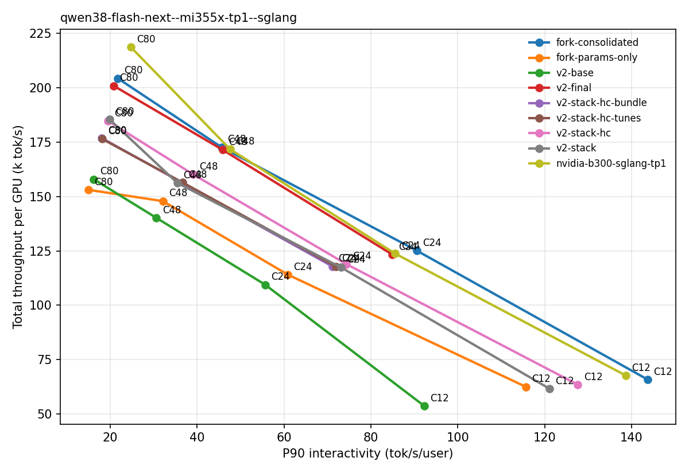

# Qwen3.8-Flash-Next on 1x MI355X (TP1): update 2026-11-05

AgentX agentic traces, 3600 s, acceptance pinned 2.32. P90 = P90 interactivity (tok/s/user), tput = total tok/s/GPU.
Final = upstream 99fd01047d + PRs 03-21 below (no C1); AITER 285579b62 + 03, 04, 18. GSM8K 96.80% (real MTP; D5 tree = final + C1).

## Where we are

| Conc | bare v2 | **final** | fork | NVIDIA B300 | vs fork (P90 / tput) | vs NVIDIA (P90 / tput) |
|---|---|---|---|---|---|---|
| 24 | 55.7 / 109.5k | **85.0 / 123.3k** | 90.6 / 125.1k | 85.6 / 123.7k | -6.2% / -1.4% | -0.8% / -0.3% |
| 48 | 30.6 / 140.2k | **45.9 / 171.5k** | 45.6 / 172.7k | 47.6 / 171.7k | +0.7% / -0.7% | -3.6% / -0.2% |
| 80 | 16.2 / 157.9k | **20.8 / 200.9k** | 21.8 / 204.3k | 24.8 / 218.7k | -4.7% / -1.6% | -16.1% / -8.1% |

- C24 = mean of 2 runs of the final tree (84.4, 85.5). The same tree + C1 gave 87.7 / 85.1 / 85.8 (mean 86.2 / 124.2k).
- C48 and C80 are one run each, on the final tree + C1.
- Single-run P90 sd is about 1.6.

## What closed the gap

- **D2 root cause (PR 16):** upstream #43463 gave the TileLang decode MQA-logits kernel a fixed number of CTAs per row.
  - With mixed context lengths that kernel took 89 -> 243 us/call (x13 layers), +1.99 ms per decode step. That was the whole fork-vs-v2 decode gap (bs18 trace, ctx 20k-200k).
  - Fix on ROCm: one CTA scores 4 consecutive groups, the grid spans the page table, num_stages=1 (fork aeddbbaf37, launch setup only). Bit-exact.
  - Effect: 1.2-1.7x kernel speed at 50k-200k ctx; agentic C24 +7.4 P90 in the A/B, +5.0 in leave-one-out.
- **D1 (PR 17):** fused QK GemmaRMSNorm + RoPE + gate on HIP, including the MTP draft: +3.7 P90 at C24 (add-one, single run).
- **The kernel stack (05, 08, 07, 11, bundle 18-21):** see the ranking below.

## Agentic C24 ranking (leave-one-out; FULL = mean of 2 runs, 84.0 / 122.2k; noise 2 sd = 3.9 P90)

| Change | P90 | tput | Within noise |
|---|---|---|---|
| 08 fused HC decode | +8.7 | +4.9k | no |
| 05 QSA FlyDSL sparse decode | +6.7 | +3.3k | no |
| 16 decode MQA-logits launch (D2) | +5.0 | +1.2k | no |
| 17 fused QK norm + RoPE + gate (D1; add-one) | +3.7 | +1.9k | yes |
| 11 QSA indexer Q pad + 256 threads | +3.1 | +1.5k | yes |
| bundle 18-21 | +2.9 | +1.1k | yes |
| 07 GDN AITER prefill (+ 03, 04) | +2.6 | +0.9k | yes |
| 13 GDN prefill views | +1.9 | +0.2k | yes |
| 15 HC prefill fusion | -1.7 | -0.2k | yes; removing 15 + C1 together costs 2.9 P90, so 15 stays |
| C1 chunk config + FP8 gather | -0.1 | +0.3k | yes; **dropped** (direct runs: -1.2 P90 / -0.85k without it, under the 2 P90 bar) |

## Final change list (all local in main-prs; nothing opened or pushed)

| PR | Lines (+/-) | Upstream |
|---|---|---|
| 03 AITER causal conv1d prefill (FlyDSL) | aiter +587/-0 | to open (alternative aiter#7028) |
| 04 AITER GDN fused prefill (FlyDSL) | aiter +1319/-1 | same change: aiter#6496 (open) |
| 05 QSA FlyDSL sparse decode | +1260/-0 | same change: sglang#45196 (open) |
| 07 GDN AITER prefill | +261/-2 | same change: sglang#44103, #41879 (open) |
| 08 fused HC decode | +693/-0 | to open |
| 11 QSA indexer Q pad | +12/-5 | to open |
| 13 GDN prefill views | +1/-1 | same change: sglang#47128, #41683 (open) |
| 15 HC prefill fusion (Nikolai Protasov) | +399/-9 | owner's PR, none found yet |
| 16 decode MQA-logits launch | +30/-5 | to open (needs 11; alternative sglang#48251); draft not opened |
| 17 fused QK norm + RoPE + gate on HIP | +11/-5 | same change: sglang#45529 (open); support it, draft not opened |
| 18 AITER GEMM tunes | aiter +418/-2 | to open (alternative aiter#5870) |
| 19 packed FP8 GDN in_proj | +18/-5 | to open (alternative sglang#39912, draft) |
| 20 lm_head AITER GEMM | +8/-1 | ours: sglang#47485 (open) |
| 21 shared attn FP8 quant | +63/-13 | to open (alternatives sglang#34502, #29723) |

## Still open

- **C80 vs NVIDIA:** -16% P90 / -8% tput, and -4.7% / -1.6% vs the fork. C48 P90 is -3.6%.
- **VRAM ceiling at mem 0.88:** runs sit at or near 309.2 / 309.2 GB (C24 G2 309.2, C80 307.7).
  - FULL L0 and L0b each had a 13-17 s KFD eviction stall.
  - There is no headroom to grow the KV or mamba pools. Runs with eviction thrash are invalid.

